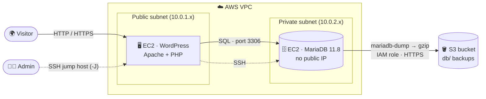
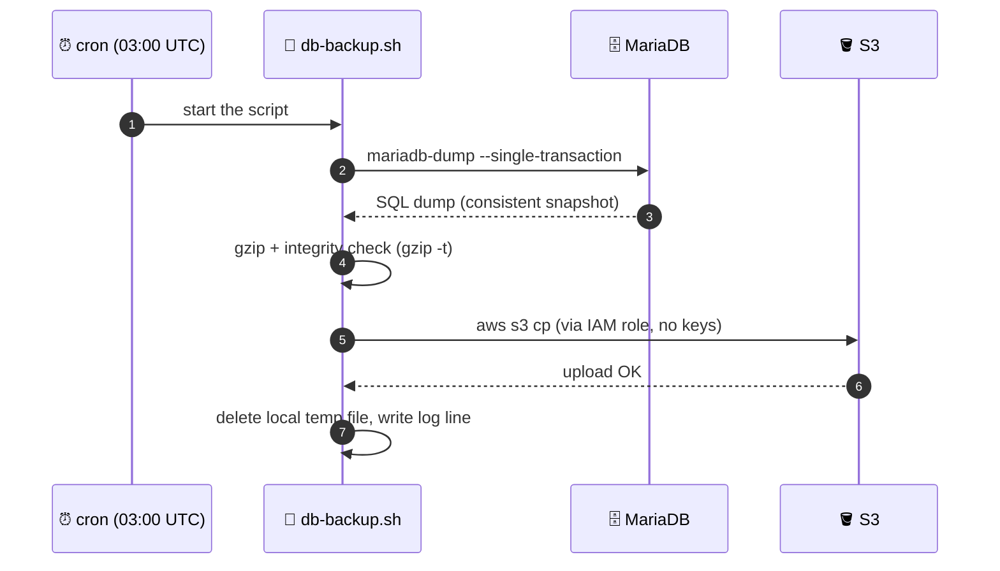

# 🛡️ Two-Tier WordPress on AWS with Automated, Verified Backups


> A WordPress site on a **public** EC2 instance, its database hidden on a **private** EC2 instance,
> and nightly backups shipped to **S3** without a single stored credential.
> And the part most tutorials skip: **I restored a backup and proved it works.**

---

## 📌 What this project is

I built a small production-style architecture from scratch in AWS to practice real infrastructure work:
network isolation, least-privilege access, backup automation, and disaster recovery.

| Goal | How it is solved |
|---|---|
| The database must not be reachable from the internet | Private subnet, no public IP, access only from the WordPress security group |
| No secrets on servers | EC2 **IAM role** (instance profile) instead of access keys |
| A leaked backup user must not be able to damage data | Dedicated **read-only** DB user for backups |
| Backups must really work | Archive integrity check + **tested restore** into a separate database |
| Backups must run without me | **cron** job, logging, and retention policy |

---

## 🗺️ Architecture



**Why two servers?** The web tier is exposed to the internet, so it is the one that gets attacked.
The database holds the valuable data, so it lives where the internet cannot reach it.
This is the classic two-tier pattern, and it also lets the web server be rebuilt without touching the data.

---

## 🔄 How a backup works



---

## 🔐 Security decisions

- **Network isolation**: the DB server sits in a private subnet with no public IP.
- **Security groups by reference**: the DB security group accepts traffic only from the WordPress security group (referenced by SG ID, not by an open CIDR range).
- **No access keys anywhere**: the backup server uses an **IAM role** attached as an instance profile. Credentials are temporary and rotated automatically by AWS.
- **Least-privilege IAM policy**: the role can only talk to one bucket (example below).
- **Least-privilege DB user**: the backup user can read data but cannot change or delete anything.
- **Secrets out of the script**: the backup DB password lives in `~/.my.cnf` with `chmod 600`, never in the script or in the process list.
- **Private bucket**: Block Public Access enabled.

### Example IAM policy

> Replace `YOUR-BUCKET` with your bucket name. `ListBucket` applies to the bucket,
> object actions apply to the objects inside it (`/*`). Mixing these up is a very common cause of `AccessDenied`.

```json
{
  "Version": "2012-10-17",
  "Statement": [
    {
      "Sid": "ListBackupBucket",
      "Effect": "Allow",
      "Action": "s3:ListBucket",
      "Resource": "arn:aws:s3:::YOUR-BUCKET"
    },
    {
      "Sid": "ReadWriteBackupObjects",
      "Effect": "Allow",
      "Action": ["s3:PutObject", "s3:GetObject"],
      "Resource": "arn:aws:s3:::YOUR-BUCKET/db/*"
    }
  ]
}
```

### Backup-only database user

```sql
CREATE USER 'backup'@'localhost' IDENTIFIED BY '<strong-password>';
GRANT SELECT, LOCK TABLES, SHOW VIEW, TRIGGER ON wordpress_db.* TO 'backup'@'localhost';
```

`~/.my.cnf` (permissions `600`):

```ini
[mariadb-dump]
user=backup
password=<strong-password>
```

---

## 📜 The backup script

`/usr/local/bin/db-backup.sh`

```bash
#!/bin/bash
set -euo pipefail

DB_NAME=wordpress_db
BUCKET=YOUR-BUCKET
TMP_DIR=/tmp
DATE=$(date +%F_%H-%M)
FILE=$TMP_DIR/${DB_NAME}_$DATE.sql.gz

mariadb-dump --single-transaction "$DB_NAME" | gzip > "$FILE"
gzip -t "$FILE"
aws s3 cp "$FILE" "s3://$BUCKET/db/"
rm -f "$FILE"
echo "$(date '+%F %T') OK $FILE" >> /var/log/db-backup.log
```

What each safety feature does:

| Line | Why it matters |
|---|---|
| `set -euo pipefail` | Stop at the first error, fail on undefined variables, and **do not hide a failure inside a pipe** |
| `--single-transaction` | Consistent snapshot of the database without locking the live site |
| `gzip -t` | Verifies the archive is not corrupted before it leaves the server |
| IAM role | `aws s3 cp` works with no keys on disk |
| `rm -f` after upload | Do not leave copies of the data lying around in `/tmp` |
| Log line | Proof that the job ran (a missing `OK` means something failed) |

### Schedule

Runs under the `ubuntu` user (so it can read `~/.my.cnf`):

```cron
0 3 * * * /usr/local/bin/db-backup.sh
```

> Server time is UTC, so this is 03:00 UTC.

---

## ♻️ Restore procedure (tested)

A backup you have never restored is only a hope. This is the procedure I ran and verified:

```bash
# 1. Download a backup
aws s3 cp s3://YOUR-BUCKET/db/<backup-file>.sql.gz /tmp/restore.sql.gz

# 2. Restore into a SEPARATE test database (never straight into production)
sudo mariadb -e "CREATE DATABASE restore_test;"
gunzip -c /tmp/restore.sql.gz | sudo mariadb restore_test

# 3. Compare against production
sudo mariadb -e "SELECT table_schema, COUNT(*) AS tables
                 FROM information_schema.tables
                 WHERE table_schema IN ('wordpress_db','restore_test')
                 GROUP BY table_schema;"

# 4. Clean up
sudo mariadb -e "DROP DATABASE restore_test;"
rm /tmp/restore.sql.gz
```

**Result:** `wordpress_db` and `restore_test` both contained **14 tables**. The backup is restorable. ✅

---

## 🧠 Problems I hit and what I learned

**1. A silent failure inside a pipe.**
When the dump command failed (missing credentials), `gzip` still compressed the empty output and `gzip -t` reported `OK`.
The result was a valid but **empty 20-byte archive** that looked like a successful backup.
Fix: `set -o pipefail` plus checking exit codes with `${PIPESTATUS[@]}`.
Lesson: *"OK" from one tool does not mean the whole chain worked.*

**2. Two databases, one name apart.**
The server had `wordpress` and `wordpress_db`. `wp-config.php` (`DB_NAME`) showed which one the site actually uses.
Lesson: *verify what you are backing up, not what you assume.*

**3. Cron has a different environment than your shell.**
Scripts that work by hand can fail in cron because of a minimal `PATH` and a different working context.
Lesson: *test the scheduled run, not only the manual one.*

**4. Reading the identity first.**
`aws sts get-caller-identity` shows which role a machine actually uses. Checking this before debugging permissions saves a lot of time.

**5. `AccessDenied` is usually a resource ARN problem.**
`s3:ListBucket` needs the bucket ARN, while `s3:PutObject` needs `bucket/*`.

---

## ✅ Status and roadmap

- [x] VPC with public and private subnets
- [x] WordPress (public) and MariaDB (private) on separate EC2 instances
- [x] S3 bucket for backups, accessed through an IAM role
- [x] Backup script with integrity checks
- [x] Restore tested end-to-end
- [x] Scheduled with cron
- [ ] S3 lifecycle rule (delete backups after 30 days)
- [ ] Back up `wp-content` (uploads, themes, plugins), not only the database
- [ ] Alerting when a backup does not run
- [ ] HTTPS with Certbot
- [ ] Monitoring (Zabbix / Prometheus + Grafana)
- [ ] Rebuild the whole stack as code (Terraform)

**Honest limitations (what I would change for production):**
backups live in the same account and region as the servers (add cross-region or cross-account replication),
the database is a single instance (consider RDS Multi-AZ), and there is no automated alert on failure yet.

---

## 🧰 Skills demonstrated

`AWS VPC` · `Subnets & routing` · `Security Groups` · `IAM roles & least privilege` · `S3` ·
`Linux administration` · `SSH jump hosts` · `MariaDB administration & users/grants` ·
`Bash scripting & error handling` · `cron` · `Backup & disaster recovery` · `Troubleshooting` · `Documentation`

---

## 📸 Screenshots

<!-- Add your own screenshots here. Blur or crop the AWS account ID before uploading. -->

| VPC & subnets | Security groups | IAM role | S3 backups |
|---|---|---|---|
| _add image_ | _add image_ | _add image_ | _add image_ |

---

## 👤 Author

**Mykhailo Hudz** · transitioning into IT infrastructure and networking · CCNA · working toward AWS Cloud Practitioner

[LinkedIn](#) · [GitHub](#)
